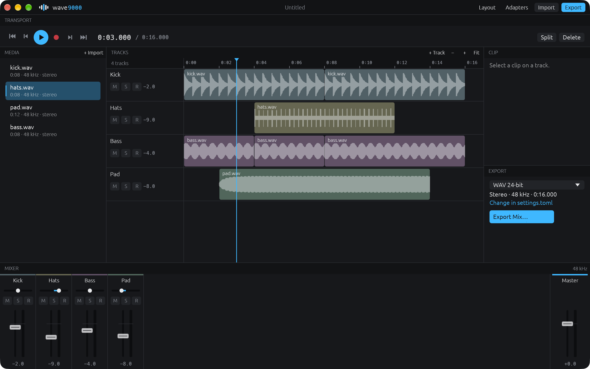

# wave9000

A bare, modular audio workstation. Record and arrange sound on tracks, mix
it, export it. Every panel can be moved, added or removed, the way
foobar2000 lets you rearrange its window. It's the sibling of
[splice9000](https://github.com/solacecasino/splice9000), the video editor,
and opens its projects.



It's a prototype (0.0.1): tracks, clips, a mixer, recording, export.
Nothing else is in the app.

## Running it

There's no download yet. Build it with Rust:

```sh
cargo build --release
./target/release/wave9000
```

Install [ffmpeg](https://ffmpeg.org) to add files other than WAV
(`brew install ffmpeg`). wave9000 runs it as a separate program for reading
and writing files, so no codecs are built in. Without it, recording, WAV
files at your sound device's rate and WAV export still work.

## Making something

1. **Drop sound files** anywhere on the window. Each goes on a new track at
   the playhead. (Or **Import…**, then drag from Media onto a track.) Video
   files work too: their sound is used.
2. **Record**: press `r`. It records onto the armed track (the **R** on a
   track), or the selected one, or a new one, from the playhead, while the
   rest plays. Press `r` or `space` to stop. The take is a WAV file beside
   your project.
3. **Move around**: click or drag on the tracks, `←` `→` to nudge, `↑` `↓`
   for the previous or next clip edge, `space` to play. Scroll sideways;
   scroll over the track names (or hold shift) to go up and down; `cmd`+scroll
   or pinch to zoom; `cmd+0` fits everything.
4. **Arrange**: drag a clip to move it, onto another track or below the
   last to make a new one. Drag its edges to trim it. `s` splits the
   selected clip at the playhead (or every clip under it), `backspace`
   removes the selected clip. Clips snap to the playhead and other clips'
   edges; hold Alt (Option) to drag freely. Exact times and a clip's own
   gain are in the Clip panel. `cmd+z` undoes.
5. **Mix**: each track has a strip in the Mixer, with a fader, a meter,
   pan, mute (`m`), solo (`shift+s`) and arm (`shift+r`). Double-click a
   fader for 0 dB, or a pan for center; hold shift for finer moves. The
   master strip is on the right.
6. **Export**: `cmd+e`. WAV 24-bit unless `settings.toml` says otherwise;
   FLAC, MP3, AAC (m4a), Ogg and Opus through ffmpeg. Type the extension
   you want in the save dialog.

Your project is kept as you work and comes back when you reopen wave9000,
even after a crash. `cmd+s` saves it as a `.wave` file to keep.

**From splice9000**: **File → Import splice9000 Project…** (or drop a
`.splice` file on the window) puts the sound of an edit on a track of its
own, each clip where it plays in the edit. Mix it, export a WAV, and drop
that back into splice9000.

## Rearranging the window

Panels sit edge to edge, divided by a single line.

- **Drag the line** between two panels to resize them.
- **Drag a panel by its header** onto the edge of another panel to sit
  beside it, or onto its middle to swap the two.
- **Right-click a header** to add a panel next to it, replace it, or remove it.
- **View → Panels** shows or hides any panel.
- **Layout** at the top (`cmd+L`) shows every panel as a block to drag.

Panels: Tracks, Mixer, Media, Transport, Clip, Export, Log, Help, Adapters.
A panel can be shown more than once.

## Adapters

wave9000 has only what you need, and adapters add the rest: commands,
panels and export formats. Drop an adapter's zip on the window to install
it; wave9000 shows what it adds and what it may do first, and never goes
online itself. None come with 0.0.1. To make one, see
[docs/adapters.md](docs/adapters.md).

## Customizing

There's no settings window. Everything is in plain text files in one folder
(`cmd+,` opens it):

| File | What it holds |
|---|---|
| `settings.toml` | sound output and input, recording, export format, ffmpeg's path, colors, track height |
| `keys.toml` | any key for any command (see the Help panel for the list) |
| `layout.toml` | the panels and where they are |
| `adapters/` | installed adapters |

Saved changes apply at once, with no restart. A file with a mistake falls
back to the defaults and the Log panel says what's wrong. The Log lists
your sound outputs and inputs by name when wave9000 starts. Where it is:

- macOS: `~/Library/Application Support/wave9000`
- Windows: `%APPDATA%\wave9000`
- Linux: `~/.config/wave9000`
- or wherever `WAVE9000_CONFIG_DIR` points

## Measured

On an M-series MacBook Air, release build, 2026-10-29:

| | |
|---|---|
| Program size | 6.6 MB (Apple Silicon only; ffmpeg not included) |
| Memory, fresh start | 56 MB (physical footprint) |
| Memory, 4 tracks of the sample project at 96 kHz | 84 MB |
| CPU when idle | 0.0% |
| Playing those 4 tracks | about 21% of one core, nearly all of it drawing the moving playhead and meters |
| The mixer alone, 16 tracks of cut-up clips at 48 kHz | 0.2% of one core (604× real time) |

Decoded sound is kept in memory: about 23 MB per stereo minute at 48 kHz,
46 MB at 96 kHz. That's what makes playing cost almost nothing, and it's
the first thing to change for long projects.

## Not yet

MIDI and instruments, plug-in effects, automation, a tempo grid, live
effects (adapters work offline, so they can't run in real time yet),
latency measured by itself (`record.offset_ms` is set by hand), downloads
and CI. Recording hasn't been tried with a real microphone yet: its parts
are tested, but the whole of it hasn't run. Run from a terminal, macOS asks
for the terminal's microphone permission.

## License

MIT
